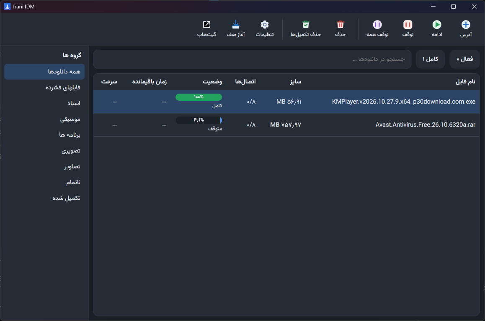
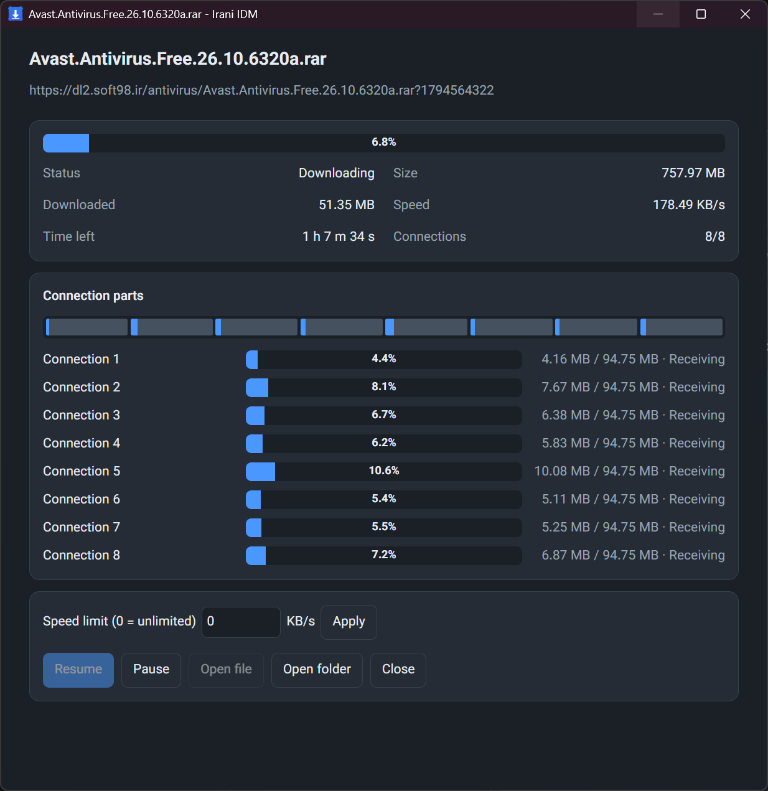
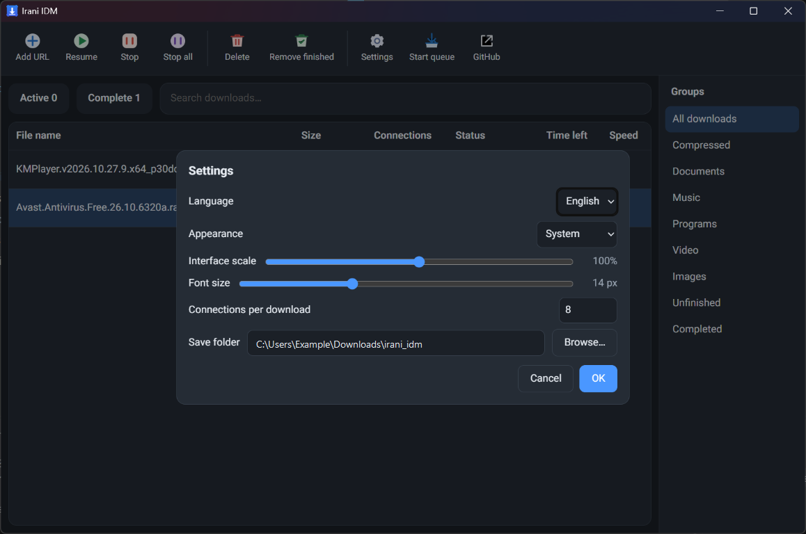

# Irani IDM — multi-connection download manager (English / فارسی)

Rust backend (reqwest + tokio) + Tauri 2 shell. The UI is plain HTML/CSS/JS in `ui/`
(no npm needed), with full RTL support for Persian.

## Features
- Dynamically balanced multi-segment downloads (default 8 connections, up to 32) with HTTP Range; each free connection splits the largest remaining part in half and downloads the new half
- Add downloads immediately while metadata is prepared in the background; probes get up to 15 seconds before falling back to a single-connection download
- Pause / resume (also after restarting the app), auto-retry, stall timeout
- System tray controls on Windows, Linux, and macOS; closing a window keeps the app running in the background
- Restore the main window's size and maximized state when the app is reopened
- Per-download speed limit, live speed / ETA, active connections and speed in the download list
- Sort downloads and view when each download was added
- Download details show the server's country and flag, whether the server supports resuming, and live connection-part progress; the expanded/collapsed state is remembered per download
- Application-wide HTTP and SOCKS5 proxy support for downloads, with optional username/password authentication
- Open each download in its own live details window sized to its connection count, with an IDM-style segmented progress bar for connection parts
- Right-click download menu for pause/resume, open, copy URL, details, and delete
- Category groups, search, queue start/stop all
- Configure up to 32 simultaneous downloads (default: 3) and optionally schedule the queue for daily local-time start/end times; the queue pauses at the end, with optional shutdown or sleep actions
- Choose an action to run after all downloads finish: shut down the computer, put it to sleep, or do nothing
- Day, night, and system appearance modes with twelve color themes (Ocean, Violet, Emerald, Sunset, Rose, Arctic, Amber, Indigo, Mint, Coral, Graphite, Pastel)
- Adjustable window transparency
- English + Persian UI (switch in Settings; RTL layout applied automatically)
- Adjustable interface scale and font size
- Application version display, GitHub project shortcut, and automatic latest-release checks with a download prompt
- Locally bundled Vazirmatn fonts and colorful vector toolbar icons for consistent rendering
- Browser integration that sends HTTP/HTTPS downloads to Irani IDM

### Recent additions (November 12–26, 2026)
- Daily download scheduling with an optional shutdown or sleep action, plus a configurable cap on simultaneous downloads.
- Adaptive connection balancing, saved connection-count and download-folder preferences, and consistent settings across manual, browser, and `iranidm://` downloads.
- Download-added timestamps and sorting, clearer update checks with release notes, and safer temporary-file handling during downloads.
- System-tray controls and background operation when the main window is closed.
- Browser handoff with first-run consent and a toolbar toggle; Chrome and Edge use automatic Native Messaging setup, and Firefox is available as a signed Mozilla Add-ons release.
- New Chinese, Russian, Arabic, Urdu, Dutch, and Spanish translations, including RTL support for Arabic and Urdu.
- The 2.0 glass interface, pastel theme, and animated sparkle effects.

## Screenshots

<table>
  <thead>
    <tr>
      <th>English</th>
      <th>فارسی</th>
    </tr>
  </thead>
  <tbody>
    <tr>
      <td><strong>Main window</strong><br></td>
      <td><strong>پنجره اصلی</strong><br></td>
    </tr>
    <tr>
      <td><strong>Download details</strong><br></td>
      <td><strong>جزئیات دانلود</strong><br></td>
    </tr>
    <tr>
      <td><strong>Settings</strong><br></td>
      <td><strong>تنظیمات</strong><br></td>
    </tr>
  </tbody>
</table>

## Prerequisites
- Rust (stable): https://rustup.rs
- `cargo install tauri-cli --version "^2"`
- **Windows:** WebView2 (preinstalled on Win 10/11) + MSVC Build Tools
- **Linux (Debian/Ubuntu):**
  `sudo apt install libwebkit2gtk-4.1-dev build-essential libssl-dev libxdo-dev libayatana-appindicator3-dev librsvg2-dev`

## VS Code
Open the repository folder in VS Code and install the recommended Rust Analyzer
and Tauri extensions when prompted. On Windows, the included tasks initialize
the MSVC build environment automatically:

- **Terminal → Run Task → Irani IDM: Dev** to run the app.
- **Ctrl+Shift+B** to build the release installers.

The VS Code tasks require the Rust toolchain, Visual Studio C++ Build Tools, and
the Tauri CLI listed above.

## Run / build
```
cd src-tauri
cargo build --bin irani-idm-native-host # required before the first dev run
cargo tauri dev                       # run
cargo tauri build                     # installers
```
Installers appear in `src-tauri/target/release/bundle/`:
Windows → `.msi` / `.exe` (NSIS); Linux → `.deb`, `.rpm`, `.AppImage`;
macOS → `.dmg`.
Build on each target OS (or use GitHub Actions with a windows + ubuntu matrix).

## Build with GitHub Actions (no local setup)
1. Push this folder to a GitHub repository.
2. Open the **Actions** tab, select **Build**, and click **Run workflow** (it also runs on every push to `main` and on pull requests).
3. When it finishes, download the packages from the run's **Artifacts**
   (`irani-idm-Windows`: .msi, NSIS installer .exe, and portable ZIP;
   `irani-idm-Linux`: .deb + .rpm + .AppImage; `irani-idm-macOS`: .dmg).
4. To publish a desktop release, create and push a version tag (for example, `git tag v1.1.1 && git push origin main v1.1.1`). The release workflow reads the version from the tag and applies it to the application before building, then attaches the desktop installers, macOS disk image, and Windows portable ZIP to a GitHub Release automatically.

## Changelog and GitHub releases
Add user-facing changes under `## [Unreleased]` in `CHANGELOG.md` as you work.
Before creating a version tag, move those notes into a matching version section
(for example, `## [1.0.4]`) and leave a fresh `## [Unreleased]` section above it.
The release workflow publishes that version's section as the GitHub Release
description. If a matching version section is missing, it uses `Unreleased`.

## Browser integration (Chrome / Edge / Firefox)

1. Install Irani IDM and launch it once so Windows can register the `iranidm://` URL handler and install the bundled Native Messaging host (this also works with the portable build).
2. Open **Settings → General → Browser integration**. The Firefox button opens the published [Mozilla Add-ons listing](https://addons.mozilla.org/en-US/firefox/addon/irani-idm-browser-integration/); Chrome and Edge open their step-by-step installation guides in the language currently selected in Settings. The Firefox guide is available from the repository for temporary testing.
3. Install Firefox directly from Mozilla Add-ons. For Chrome and Edge, download the matching ZIP from a GitHub release, extract it, then use **Developer mode → Load unpacked**. Restart Irani IDM after loading either Chrome or Edge extension; the app discovers its ID and registers Native Messaging automatically.
4. After installation, review the extension's first-run consent page. Download handoff is disabled until the user explicitly enables it. Use the Irani IDM toolbar button to turn download catching on or off at any time; the full Options page remains available for privacy details. If no choice has been saved and the user starts a download, the extension opens Options once to remind them; it never enables handoff automatically. Firefox additionally asks for its optional download-URL and download-action data permissions; handoff stays disabled if either is denied or revoked. Once enabled, HTTP/HTTPS downloads started in the browser are handed to Irani IDM and saved in the app's Downloads folder using its default eight connections. Turning handoff off leaves downloads in the browser. Links requiring an authenticated browser session, cookies, or browser-only headers may not be downloadable by the app.

The complete [English and Persian browser installation guides](docs/extensions/README.md) are also available directly in the repository.

### Browser store publication

The Firefox add-on is [published on Mozilla Add-ons](https://addons.mozilla.org/en-US/firefox/addon/irani-idm-browser-integration/). The Chrome Web Store and Microsoft Edge Add-ons listings are
being prepared but are **not published yet**. Publishing those listings
requires the publisher's enrolled developer account and approval from each
store. Chrome Web Store developer registration currently requires a one-time
$5 fee and is limited to Google's supported registration countries/regions
(Iran is not currently listed). Microsoft Edge extension developer
registration has no registration fee. The extension
packages, privacy policy, listing descriptions, reviewer notes, and store
graphics are maintained under `browser-extension/`. See
[`STORE_LISTING.md`](browser-extension/STORE_LISTING.md) for preparation
commands and the browser-specific listing files.

The Windows portable ZIP contains `irani-idm.exe` and its `irani-idm-native-host.exe`
companion; keep both files together when extracting and running the app. Windows
WebView2 Runtime is still required (it is preinstalled on most Windows 10/11 systems).

Icons are generated from `app-icon.png` if `src-tauri/icons/` doesn't exist. Replace `app-icon.png` with your own logo (1024x1024 PNG) any time.

## Ideas for next steps
YouTube/HLS support.
