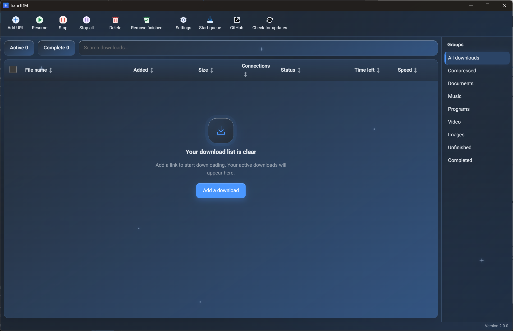
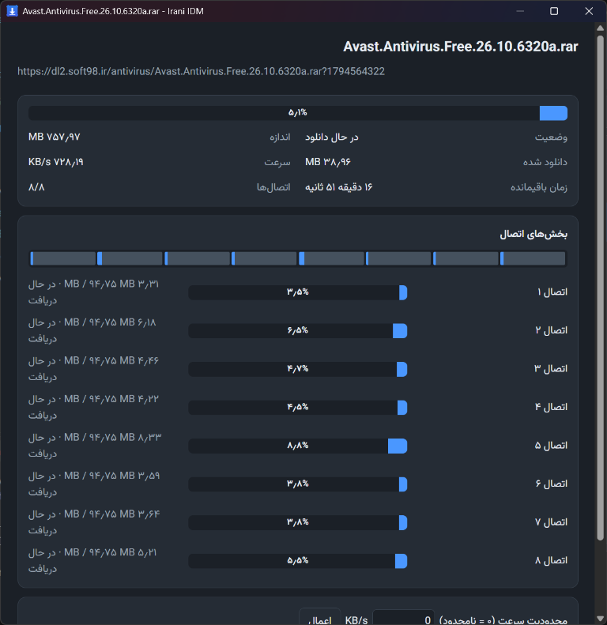
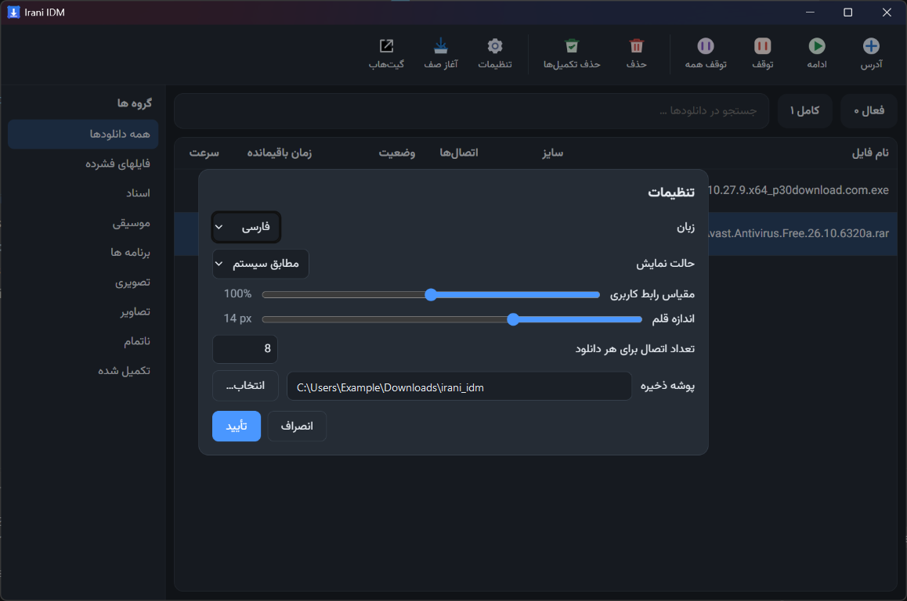

# Irani IDM — multi-connection download manager (English / فارسی)

Rust backend (reqwest + tokio) + Tauri 2 shell. The UI is plain HTML/CSS/JS in `ui/`
(no npm needed), with full RTL support for Persian.

## Features
- Multi-segment downloads (default 8 connections, up to 32) with HTTP Range
- Add downloads immediately while metadata is prepared in the background; probes get up to 15 seconds before falling back to a single-connection download
- Pause / resume (also after restarting the app), auto-retry, stall timeout
- Per-download speed limit, live speed / ETA, active connections and speed in the download list
- Application-wide HTTP and SOCKS5 proxy support for downloads, with optional username/password authentication
- Open each download in its own live details window sized to its connection count, with an IDM-style segmented progress bar for connection parts
- Right-click download menu for pause/resume, open, copy URL, details, and delete
- Category groups, search, queue start/stop all
- Day, night, and system appearance modes with eleven color themes (Ocean, Violet, Emerald, Sunset, Rose, Arctic, Amber, Indigo, Mint, Coral, Graphite)
- English + Persian UI (switch in Settings; RTL layout applied automatically)
- Adjustable interface scale and font size
- GitHub project shortcut and automatic latest-release checks with a download prompt
- Locally bundled Vazirmatn fonts and colorful vector toolbar icons for consistent rendering

## Screenshots

<table>
  <thead>
    <tr>
      <th>English</th>
      <th>فارسی</th>
    </tr>
  </thead>
  <tbody>
    <tr>
      <td><strong>Main window</strong><br></td>
      <td><strong>پنجره اصلی</strong><br></td>
    </tr>
    <tr>
      <td><strong>Download details</strong><br></td>
      <td><strong>جزئیات دانلود</strong><br></td>
    </tr>
    <tr>
      <td><strong>Settings</strong><br></td>
      <td><strong>تنظیمات</strong><br></td>
    </tr>
  </tbody>
</table>

## Prerequisites
- Rust (stable): https://rustup.rs
- `cargo install tauri-cli --version "^2"`
- **Windows:** WebView2 (preinstalled on Win 10/11) + MSVC Build Tools
- **Linux (Debian/Ubuntu):**
  `sudo apt install libwebkit2gtk-4.1-dev build-essential libssl-dev libxdo-dev libayatana-appindicator3-dev librsvg2-dev`

## VS Code
Open the repository folder in VS Code and install the recommended Rust Analyzer
and Tauri extensions when prompted. On Windows, the included tasks initialize
the MSVC build environment automatically:

- **Terminal → Run Task → Irani IDM: Dev** to run the app.
- **Ctrl+Shift+B** to build the release installers.

The VS Code tasks require the Rust toolchain, Visual Studio C++ Build Tools, and
the Tauri CLI listed above.

## Run / build
```
cd src-tauri
cargo tauri dev                       # run
cargo tauri build                     # installers
```
Installers appear in `src-tauri/target/release/bundle/`:
Windows → `.msi` / `.exe` (NSIS); Linux → `.deb`, `.rpm`, `.AppImage`;
macOS → `.dmg`.
Build on each target OS (or use GitHub Actions with a windows + ubuntu matrix).

## Build with GitHub Actions (no local setup)
1. Push this folder to a GitHub repository.
2. Open the **Actions** tab, select **Build**, and click **Run workflow** (it also runs on every push to `main` and on pull requests).
3. When it finishes, download the packages from the run's **Artifacts**
   (`irani-idm-Windows`: .msi, NSIS installer .exe, and portable ZIP;
   `irani-idm-Linux`: .deb + .rpm + .AppImage; `irani-idm-macOS`: .dmg).
4. To publish a desktop release, create and push a version tag (for example, `git tag v1.1.1 && git push origin main v1.1.1`). The release workflow reads the version from the tag and applies it to the application before building, then attaches the desktop installers, macOS disk image, and Windows portable ZIP to a GitHub Release automatically.

## Changelog and GitHub releases
Add user-facing changes under `## [Unreleased]` in `CHANGELOG.md` as you work.
Before creating a version tag, move those notes into a matching version section
(for example, `## [1.0.4]`) and leave a fresh `## [Unreleased]` section above it.
The release workflow publishes that version's section as the GitHub Release
description. If a matching version section is missing, it uses `Unreleased`.

The Windows portable ZIP contains `irani-idm.exe`; extract it and run the executable
without installing the app. Windows WebView2 Runtime is still required (it is
preinstalled on most Windows 10/11 systems).

Icons are generated from `app-icon.png` if `src-tauri/icons/` doesn't exist. Replace `app-icon.png` with your own logo (1024x1024 PNG) any time.

## Ideas for next steps
Scheduler, browser extension / clipboard capture, download queue concurrency limit,
proxy + auth settings, YouTube/HLS support, system tray.
